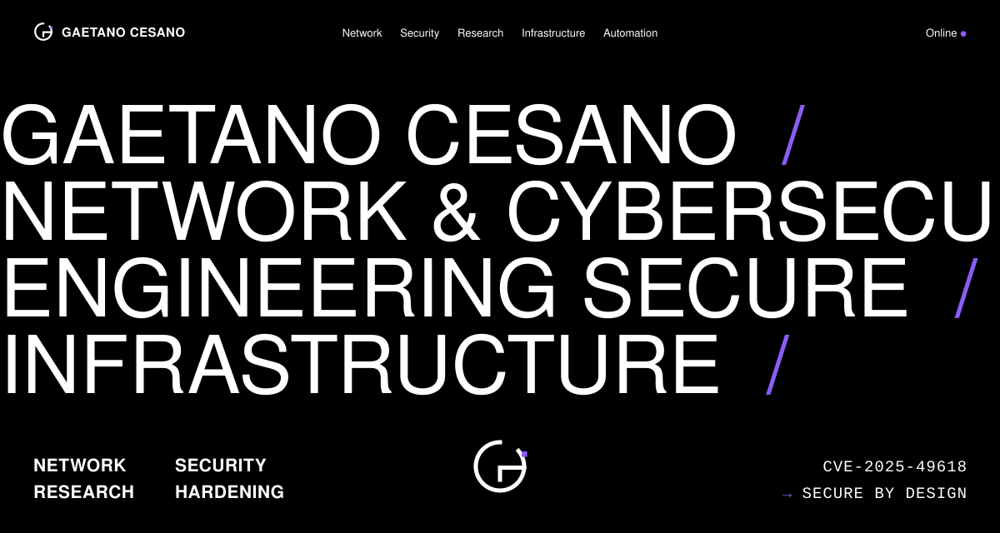
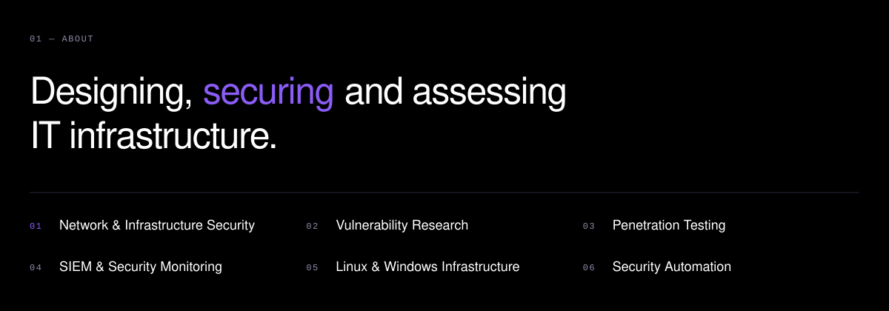
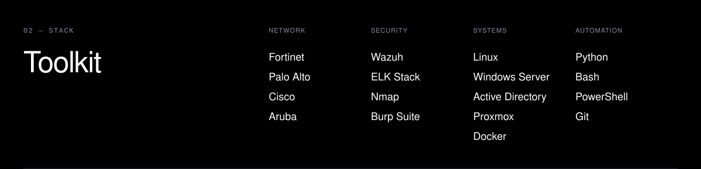
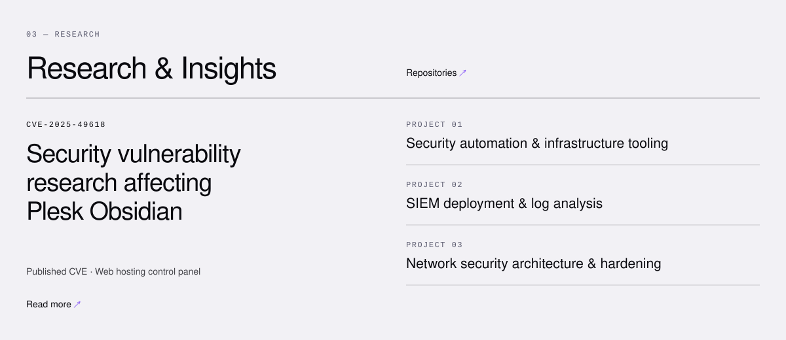
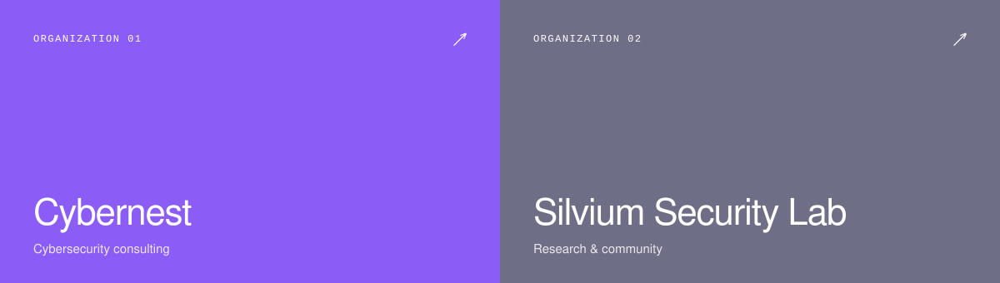
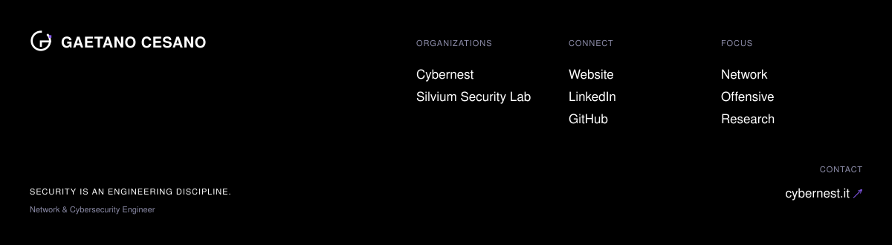

  <a href="https://cybernest.it">Website ↗</a>&nbsp;&nbsp;·&nbsp;&nbsp;
  <a href="https://www.linkedin.com/in/cesano/">LinkedIn ↗</a>&nbsp;&nbsp;·&nbsp;&nbsp;
  <a href="https://github.com/zSkallywag?tab=repositories">Repositories ↗</a>

