<!--
  ╔══════════════════════════════════════════════════════════════╗
  ║  SILVIUM SECURITY LAB // OPERATOR PROFILE                    ║
  ║  Replace every zSkallywag with your GitHub username.      ║
  ╚══════════════════════════════════════════════════════════════╝
-->

<div align="center">



<br/>

<a href="https://cybernest.it"></a>
<a href="https://www.linkedin.com/in/cesano/"></a>


<br/><br/>



</div>


## ░▒▓ 01 :: OPERATOR PROFILE

```ini
[operator]
name        = Gaetano Cesano
role        = Network & Cybersecurity Engineer
directive   = design, secure and assess IT infrastructures
focus       = network security · vulnerability research · security monitoring · hardening
```

> I'm a **Network & Cybersecurity Engineer** focused on designing, securing and assessing IT infrastructures.
> My work involves network security, vulnerability research, security monitoring and infrastructure hardening.

<div align="center">

</div>


## ░▒▓ 02 :: ARSENAL

<table>
<tr>
<td width="200"><b><code>▸ SECURITY &amp; NETWORKING</code></b></td>
<td>


</td>
</tr>
<tr>
<td><b><code>▸ SYSTEMS &amp; INFRA</code></b></td>
<td>


</td>
</tr>
<tr>
<td><b><code>▸ DEV &amp; AUTOMATION</code></b></td>
<td>


</td>
</tr>
</table>


## ░▒▓ 03 :: FIELD OPERATIONS

<div align="center">
<a href="https://nvd.nist.gov/vuln/detail/CVE-2025-49618">

</a>
</div>

<br/>

| STATUS | OPERATION | DESCRIPTION |
|:---:|:---|:---|
| 🟣 `LOGGED` | **CVE-2025-49618** | Security vulnerability research affecting Plesk Obsidian |
| 🔵 `ACTIVE` | **Security Automation** | Automation and infrastructure tooling |
| 🔵 `ACTIVE` | **SIEM Deployment** | SIEM deployment and log analysis |
| 🔵 `ACTIVE` | **Network Hardening** | Network security architecture and hardening |


## ░▒▓ 04 :: FACTIONS

<table>
<tr>
<td width="50%" valign="top">

### ◈ Cybernest
`CYBERSECURITY CONSULTING`

Cybersecurity consulting: designing, securing and assessing IT infrastructures.

<a href="https://cybernest.it"></a>

</td>
<td width="50%" valign="top">

### ◈ Silvium Security Lab
`RESEARCH & COMMUNITY`

Cybersecurity research and community initiatives.


</td>
</tr>
</table>


## ░▒▓ 05 :: TELEMETRY

<div align="center">


<!-- Contribution snake — generated by .github/workflows/snake.yml (run it once from the Actions tab) -->


</div>


## ░▒▓ 06 :: COMMS UPLINK

<div align="center">

```console
root@ssl:~$ ./connect --secure
```

<a href="https://cybernest.it"></a>
<a href="https://www.linkedin.com/in/cesano/"></a>
<a href="https://github.com/zSkallywag"></a>

</div>

<br/>


