<h2>Gaetano Cesano</h2>

**Network & Cybersecurity Engineer**

Working across network security, infrastructure engineering and vulnerability research.

- Network & Infrastructure Security
- Vulnerability Research & Penetration Testing
- SIEM & Security Monitoring
- Python & Security Automation

**Tech:** Fortinet · Palo Alto · Cisco · Wazuh · Linux · Python · Proxmox

**Projects:** [Cybernest](https://cybernest.it) · [Silvium Security Lab](https://silviumsecuritylab.com)

[LinkedIn](https://www.linkedin.com/in/cesano/) · [Website](https://cybernest.it)
