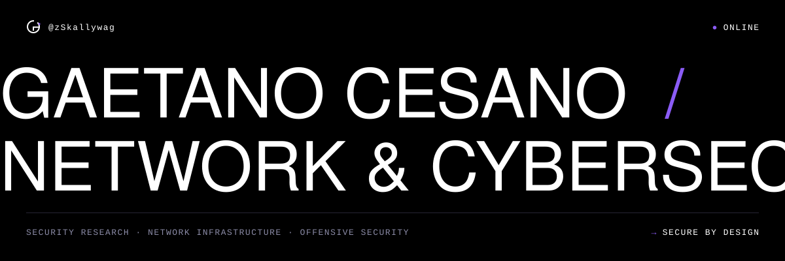
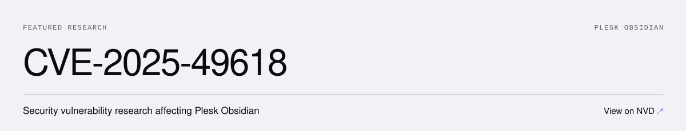

### 01 — About

Network & Cybersecurity Engineer. I design, secure and assess IT infrastructure.

`Network Security` `Vulnerability Research` `Penetration Testing` `SIEM & Monitoring` `Infrastructure Hardening` `Security Automation`

### 02 — Stack

**Network** &nbsp; `Fortinet` `Palo Alto` `Cisco` `Aruba` 
**Security** &nbsp; `Wazuh` `ELK Stack` `Nmap` `Burp Suite` 
**Systems** &nbsp; `Linux` `Windows Server` `Active Directory` `Proxmox` `Docker` 
**Automation** &nbsp; `Python` `Bash` `PowerShell` `Git`

### 03 — Research

- Security automation & infrastructure tooling
- SIEM deployment & log analysis
- Network security architecture & hardening

### 04 — Organizations

**[Cybernest](https://cybernest.it)** — cybersecurity consulting 
**Silvium Security Lab** — security research & community

### 05 — Contact

[cybernest.it](https://cybernest.it) &nbsp;·&nbsp; [LinkedIn](https://www.linkedin.com/in/cesano/)

 

<i>Security is an engineering discipline.</i>

